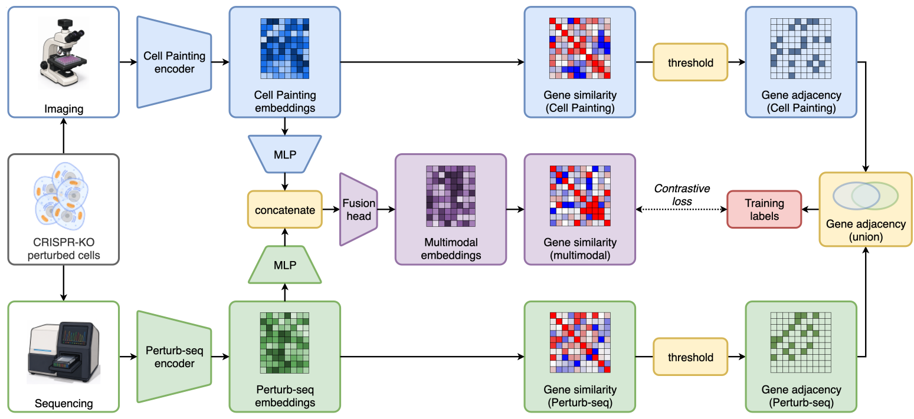

# Multimodal fusion 

Official implementation for "Multimodal modeling of Cell Painting and Perturb-seq from hiPSC-derived neurons"; learning a multimodal representation of PerturbSeq and Cell Painting data by fusing **frozen** unimodal representations. Training is self-supervised: pseudo-labels are inferred from within-batch cosine similarity in each modality (soft union) and supervised contrastive learning is used to udpate model weights based on these pseudo-labels. This can be viewed as learning a superposition of high-confidence cosine similarity adjacency graphs in each modality. An optional synergy term is used so the fused vector does not collapse to a unimodal surrogate. Note that pathway or gene-set labels are **not** used during training.



Default hyperparameters and architecture widths match `configs/train.yaml`.
## Requirements

- Python 3.12
- CUDA GPU(s) recommended (config uses PyTorch Lightning DDP when `trainer.devices` > 1)

```sh
git clone <REPO_URL> multimodal-fusion
cd multimodal-fusion
python -m venv .venv
source .venv/bin/activate
uv pip install -r requirements.txt
```

## Data

Frozen features from each modality can be provided through one or more files per modality with following requirements:
- Each file should contain **one row per replicate (sample)**.
- Embedding columns should be named `d` + digits (e.g. `d0001` to `d1023` for a 1024D embedding).
- Metadata for each sample should contain the gene KO label for that sample, this is used to weakly pair the data across two modalities.

Only gene KO labels present in **both** modalities are used. During training, each sample is the mean of `num_pairs` (default 4) replicates drawn from the same gene KO label. The test dataset uses the mean of **all** replicates per gene.

Point Hydra at your files:

```sh
python train.py \
  'data.ps_data_path=[PATH_TO_PS_EMBEDDINGS]' \
  'data.cp_data_path=[PATH_TO_CP_EMBEDDINGS]'
```

## Training

Single GPU (defaults in `configs/train.yaml`):

```sh
python train.py
```

Multi-GPU and optional logging overrides:

```sh
python train.py \
  trainer.devices=8 \
  'data.ps_data_path=[PATH_TO_PS_EMBEDDINGS]' \
  'data.cp_data_path=[PATH_TO_CP_EMBEDDINGS]' \
  logger.wandb.entity=YOUR_ENTITY
```

- Artifacts: `logs/multimodal-fusion/<timestamp>/` (checkpoints, `train.log`, Hydra config snapshot).
- Set `logger=null` to disable Weights & Biases.
- Set `ckpt_path=/path/to/checkpoint.ckpt` to resume or evaluate only (`train: false`, `test: true`).

After training, Lightning runs `test` using the best checkpoint on the gene-mean-pooled test set.


## Repository layout

```
configs/train.yaml   # Hydra config (data, model, trainer, callbacks)
train.py             # Entry point
models/model.py      # UnionSupConModel
data/                # Data loaders
utils/ema_callback.py # EMA checkpoint callback
```

## Contact

For questions about reproduction or the manuscript, open an issue in this repository or contact the corresponding author listed in the paper.
